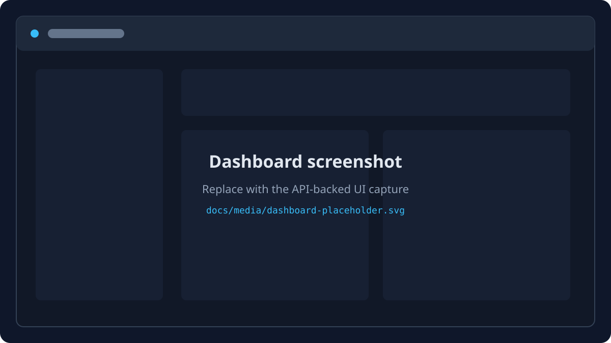
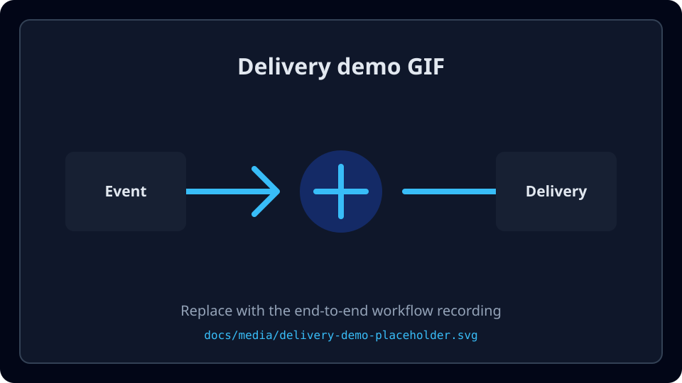

# HookForge

HookForge is a small, production-style webhook delivery platform. It is being
built incrementally to demonstrate durable event persistence, asynchronous
delivery, HMAC signatures, retry policy, tenant isolation, and operational
observability without requiring a heavyweight local stack.

## Current implementation

The repository currently contains the following working slices:

- TypeScript strict-mode npm workspace for API, worker, web, and shared code.
- Fastify API with `/health`, `/ready`, and `/metrics`.
- Zod environment validation, Pino-backed Fastify logging, security headers, and
  restricted local CORS defaults.
- PostgreSQL 16 and Redis 7 Alpine Compose services tuned for local ARM64 use.
- Transactional SQL migration runner with advisory-lock protection.
- PostgreSQL domain schema for users, sessions, projects, endpoints, and
  encrypted secret versions.
- Bearer-token authentication and tenant-scoped project/endpoint APIs.
- Idempotent event ingestion with atomic delivery fan-out for active endpoints.
- PostgreSQL-backed worker with leases, bounded HTTP delivery, HMAC signatures,
  retry scheduling, attempt history, and abandoned-lease recovery.
- Paginated delivery inspection, attempt-history detail, replay, and lease
  reconciliation APIs.
- API-backed React dashboard for projects, endpoints, events, and deliveries.
- ARM64-conscious multi-stage Docker images and Compose startup orchestration.
- Bounded API rate limits, safe operational metrics, worker heartbeat health,
  and a configurable k6 benchmark harness.
- SSRF-aware endpoint URL validation and lifecycle actions.
- Unit and route tests for health, authentication, tenant isolation, crypto,
  endpoint lifecycle, URL policy, and the OpenAPI contract.
- Deterministic OpenAPI 3.1 generation at `/openapi.json`, with a checked-in
  artifact and CI freshness verification.

The API contract is generated from the implemented route surface and checked in
as `docs/api/openapi.json`; CI verifies that it remains current.

## Architecture direction

HookForge will remain a modular monolith with separate API and worker processes.
PostgreSQL is the source of truth for projects, endpoints, events, deliveries,
and attempts. The delivery queue will be PostgreSQL-backed and claimed with
`FOR UPDATE SKIP LOCKED`, so event creation and initial delivery scheduling can
share a transaction. Redis is reserved for short-lived coordination and rate
limiting; it will not be the only location for important event data.

See [the architecture overview](docs/architecture/ARCHITECTURE.md),
[the diagrams](docs/architecture/diagrams.md), and the decision records in
`docs/architecture/decisions/`.

## Technology

- Node.js 22 LTS-compatible runtime, TypeScript, Fastify, Zod, and Pino
- PostgreSQL 16 with `pg` and SQL migrations
- Redis 7 for ephemeral coordination
- React, Vite, and TypeScript for the dashboard
- Vitest, ESLint, Prettier, Docker Compose, and GitHub Actions

## Prerequisites

- Node.js 22.x and npm 10.x
- Docker Desktop for Apple Silicon with the Docker daemon running
- Git

The checked environment is ARM64. Compose uses Alpine images with ARM64
manifests and keeps PostgreSQL and Redis resource usage conservative.

## Quick start

```bash
cp .env.example .env
npm install
docker compose up -d
```

Compose builds and starts the migration job, API, worker, and web dashboard.
The dashboard is available at `http://localhost:5173`; the API is available at
`http://localhost:3000`. PostgreSQL and Redis ports are intentionally private to
the Compose network.

To run only PostgreSQL and Redis while running the application processes on the
host, use the debug override:

```bash
docker compose -f docker-compose.yml -f docker-compose.debug.yml up -d postgres redis
npm run db:migrate
npm run dev:api
npm run start:worker
npm run dev:web
```

For an explicit image rebuild, use `npm run compose:build`. Application images
are built from the repository root and do not copy host `node_modules`, which
keeps native dependencies compatible with Linux ARM64.

The local `.env.example` encryption key is intentionally a known development
value. Replace it before sharing a development environment or deploying
anywhere. Production startup requires `SECRET_ENCRYPTION_KEY` to be supplied.

## Commands

```bash
npm run format:check
npm run lint
npm run typecheck
npm test
npm run test:integration
npm run build
npm run openapi:generate
npm run openapi:check
npm run compose:logs
npm run compose:ps
npm run compose:build
npm run compose:down
```

Run `docker system df` to inspect disk usage. Remove only this project's
stopped containers and images after inspection; never remove the named
`hookforge_postgres_data` volume unless you explicitly intend to reset local
data. The explicit reset command will be documented when the complete Compose
stack is available.

The explicit reset command for local data is:

```bash
docker compose down
docker volume rm hookforge_postgres_data
```

Run it only after confirming that local data can be discarded; it is never part
of the normal setup or cleanup flow.

## Documentation

- [API documentation](docs/api/API.md)
- [Development guide](docs/development/DEVELOPMENT.md)
- [Security notes](docs/security/SECURITY.md)
- [Operations runbook](docs/operations/RUNBOOK.md)
- [Contributing](CONTRIBUTING.md)

## Screenshots and demo

The media slots below are intentionally labeled placeholders until updated
captures are available from the API-backed dashboard and delivery workflow.





Replace these files with the real dashboard screenshot and delivery demo GIF;
the README links can remain unchanged.

## Current limitations and roadmap

The current milestone accepts, schedules, delivers, inspects, and replays
events through the API and standalone worker process, with the dashboard,
Docker deployment, operational observability, and OpenAPI contract now present.
Future work should be driven by measured product and scale requirements rather
than adding an unverified platform component.

`npm test` runs fast in-memory unit and route tests. Once PostgreSQL and Redis
are running, `npm run test:integration` applies migrations and runs the real
PostgreSQL event-ingestion checks.
Benchmarks will be added only after delivery is functional and will report
measured values with their test environment.
