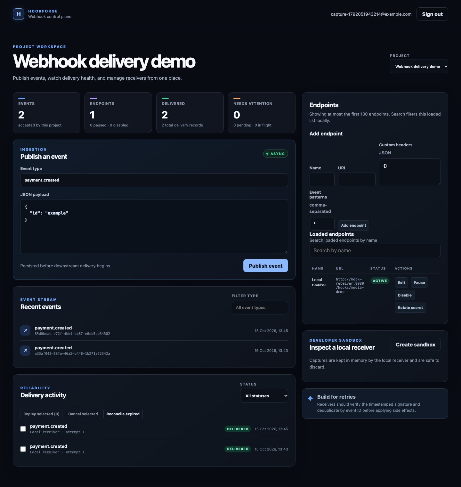
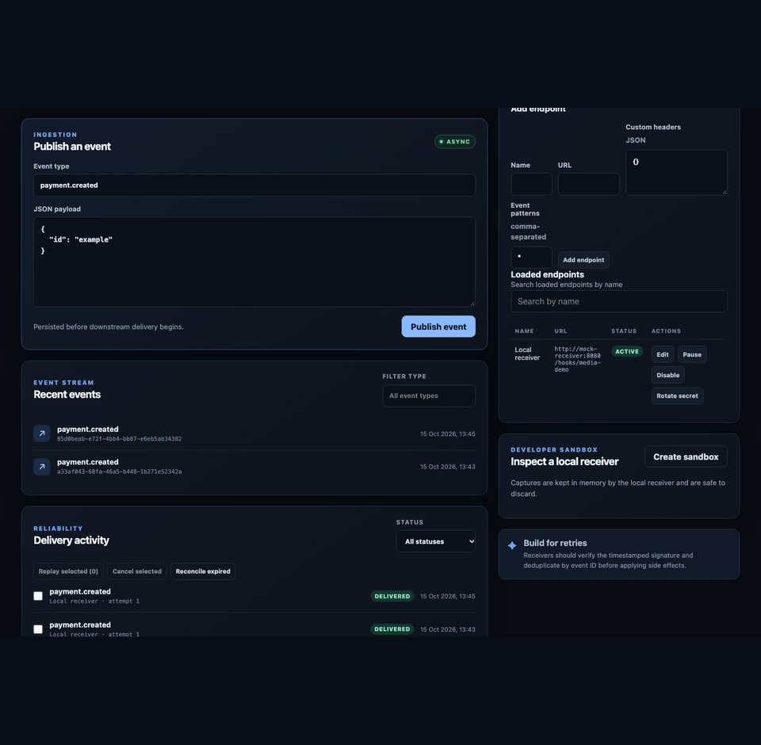

# HookForge

HookForge is a small, production-style webhook delivery platform. It is being
built incrementally to demonstrate durable event persistence, asynchronous
delivery, HMAC signatures, retry policy, tenant isolation, and operational
observability without requiring a heavyweight local stack.

## Current implementation

The repository currently contains the following working slices:

- TypeScript strict-mode npm workspace for API, worker, web, and shared code.
- Fastify API with `/health`, `/ready`, JSON `/metrics`, and Prometheus
  `/metrics/prometheus` exposition.
- Zod environment validation, Pino-backed Fastify logging, security headers, and
  restricted local CORS defaults.
- PostgreSQL 16 and Redis 7 Alpine Compose services tuned for local ARM64 use.
- Transactional SQL migration runner with advisory-lock protection.
- PostgreSQL domain schema for users, sessions, projects, endpoints, and
  encrypted secret versions.
- Bearer-token authentication and tenant-scoped project/endpoint APIs.
- Idempotent event ingestion with atomic, pattern-filtered delivery fan-out for
  active endpoints.
- Encrypted per-endpoint static headers, one-time secret display, and immutable
  delivery snapshots for URL, signing secret, headers, and routing decisions.
- PostgreSQL-backed worker with leases, bounded HTTP delivery, HMAC signatures,
  retry scheduling, attempt history, abandoned-lease recovery, and shared
  per-endpoint/project in-flight quotas.
- Paginated delivery inspection, attempt-history detail, replay, bulk replay and
  cancellation, dead-letter metadata, alert routing, and lease reconciliation
  APIs.
- A bounded, in-memory `mock-receiver` Compose service and dashboard sandbox for
  inspecting real outbound requests locally.
- API-backed React dashboard for projects, endpoints, events, and deliveries.
- ARM64-conscious multi-stage Docker images and Compose startup orchestration.
- Distributed Redis token bucket rate limits, safe operational metrics, worker
  heartbeat health, and a configurable k6 benchmark harness.
- Monthly RANGE-partitioned historical archives for events, deliveries, and
  attempts, with an advisory-locked retention runner and Compose maintenance
  service.
- Optional HashiCorp Vault Transit envelope encryption with versioned wrapped
  data keys, zero-downtime key rotation, and database audit events.
- OpenTelemetry W3C trace context persisted through the PostgreSQL queue and
  continued through worker delivery to receiver HTTP requests.
- SSRF-aware endpoint URL validation and lifecycle actions, including worker
  socket pinning against DNS rebinding.
- Unit and route tests for health, authentication, tenant isolation, crypto,
  endpoint lifecycle, URL policy, and the OpenAPI contract.
- Deterministic OpenAPI 3.1 generation at `/openapi.json`, with a checked-in
  artifact and CI freshness verification.

The API contract is generated from the implemented route surface and checked in
as `docs/api/openapi.json`; CI verifies that it remains current.

## Architecture direction

HookForge will remain a modular monolith with separate API and worker processes.
PostgreSQL is the source of truth for projects, endpoints, events, deliveries,
and attempts. The delivery queue will be PostgreSQL-backed and claimed with
`FOR UPDATE SKIP LOCKED`, so event creation and initial delivery scheduling can
share a transaction. Redis holds ephemeral shared rate-limit state;
PostgreSQL remains the durable delivery queue.

See [the architecture overview](docs/architecture/ARCHITECTURE.md),
[the diagrams](docs/architecture/diagrams.md), and the decision records in
`docs/architecture/decisions/`.

## Technology

- Node.js 22 LTS-compatible runtime, TypeScript, Fastify, Zod, and Pino
- PostgreSQL 16 with `pg` and SQL migrations
- Redis 7 for distributed rate limiting and ephemeral coordination
- React, Vite, and TypeScript for the dashboard
- Vitest, ESLint, Prettier, Docker Compose, and GitHub Actions

## Prerequisites

- Node.js 22.x and npm 10.x
- Docker Desktop for Apple Silicon with the Docker daemon running
- Git

The checked environment is ARM64. Compose uses Alpine images with ARM64
manifests and keeps PostgreSQL and Redis resource usage conservative.

## Quick start

```bash
cp .env.example .env
npm install
docker compose up -d
```

Compose builds and starts the migration job, API, worker, retention runner, mock receiver, and web dashboard.
The dashboard is available at `http://localhost:5173`; the API is available at
`http://localhost:3000`. The mock receiver is available at
`http://localhost:8080`; PostgreSQL and Redis ports are intentionally private to
the Compose network. Create a sandbox endpoint from the dashboard to capture
signed requests without deploying another service.

To run only PostgreSQL and Redis while running the application processes on the
host, use the debug override:

```bash
docker compose -f docker-compose.yml -f docker-compose.debug.yml up -d postgres redis mock-receiver
npm run db:migrate
npm run dev:api
npm run start:worker
npm run dev:web
```

For an explicit image rebuild, use `npm run compose:build`. Application images
are built from the repository root and do not copy host `node_modules`, which
keeps native dependencies compatible with Linux ARM64.

The local `.env.example` encryption key is intentionally a known development
value. Replace it before sharing a development environment or deploying
anywhere. For production, set `ENVELOPE_PROVIDER=vault`, Vault Transit
credentials, and `VAULT_TRANSIT_KEY`; keep `SECRET_ENCRYPTION_KEY` available
until legacy ciphertext has been re-encrypted. Legacy mode still requires
`SECRET_ENCRYPTION_KEY` in production.

The retention service runs `npm run db:retention` once per
`RETENTION_INTERVAL_SECONDS`. It archives only terminal event graphs, keeps
the live hot tables bounded by `ARCHIVE_AFTER_MONTHS`, and drops archive
partitions older than `PURGE_AFTER_MONTHS`. Use `RETENTION_DRY_RUN=true` for a
safe preview.

To rotate the active Vault-wrapped data key without stopping API or workers:

```bash
npm run db:rotate-encryption-key
```

Old key versions remain in `retiring` state so queued deliveries can continue
to decrypt while new endpoint secrets use the new version.

## Rate limiting

The default limiter uses an atomic Redis Lua token bucket and Redis server
`TIME`. Registration and login share a bucket per trusted socket IP; event
ingestion uses the authenticated user/project pair, with a socket-IP fallback
for unauthorized attempts. `X-Forwarded-For` is not trusted.

Defaults allow an initial burst of 10 auth requests or 120 event requests per
scope. An empty bucket refills continuously to full capacity over 60 seconds
without further consumption, rather than resetting at fixed window boundaries.
All API replicas must use the same Redis database and `RATE_LIMIT_*` policies.
Exhausted buckets return `429 RATE_LIMIT_EXCEEDED` with `Retry-After` in seconds
until the next token; Redis failures return `503 RATE_LIMIT_UNAVAILABLE` with
no local fallback.
`/health`, `/ready`, and `/metrics` are not rate limited; readiness checks Redis.

Compose uses Redis `noeviction` with persistence disabled. Redis restart or
flush loses quotas, and quota continuity through restart or failover is not
guaranteed. Accepted events and delivery work remain durable in PostgreSQL.
See the [API contract](docs/api/API.md#rate-limits) and
[operational guidance](docs/operations/RUNBOOK.md#rate-limits).

## Commands

```bash
npm run format:check
npm run lint
npm run typecheck
npm test
npm run test:integration
npm run build
npm run openapi:generate
npm run openapi:check
npm run compose:logs
npm run compose:ps
npm run compose:build
npm run compose:down
npm run db:retention
npm run db:rotate-encryption-key
```

Run `docker system df` to inspect disk usage. Remove only this project's
stopped containers and images after inspection; never remove the named
`hookforge_postgres_data` volume unless you explicitly intend to reset local
data. The explicit reset command will be documented when the complete Compose
stack is available.

The explicit reset command for local data is:

```bash
docker compose down
docker volume rm hookforge_postgres_data
```

Run it only after confirming that local data can be discarded; it is never part
of the normal setup or cleanup flow.

## Documentation

- [API documentation](docs/api/API.md)
- [Development guide](docs/development/DEVELOPMENT.md)
- [Security notes](docs/security/SECURITY.md)
- [Operations runbook](docs/operations/RUNBOOK.md)
- [Contributing](CONTRIBUTING.md)

## Screenshots and demo

The captures below come from the API-backed dashboard and delivery workflow.





The captures show the API-backed dashboard, a delivered local receiver request, event
ingestion, delivery status changes, and delivery-attempt inspection.

## Current limitations and roadmap

The current milestone accepts, routes, schedules, delivers, inspects, replays,
and cancels events through the API and standalone worker process. It also
includes endpoint subscriptions, encrypted custom headers, a local receiver,
bulk delivery operations, and signed dead-letter alerts.

`npm test` runs fast in-memory unit and route tests. Once PostgreSQL and Redis
are running, `npm run test:integration` applies migrations and runs the real
PostgreSQL event-ingestion checks.
Benchmarks will be added only after delivery is functional and will report
measured values with their test environment.
