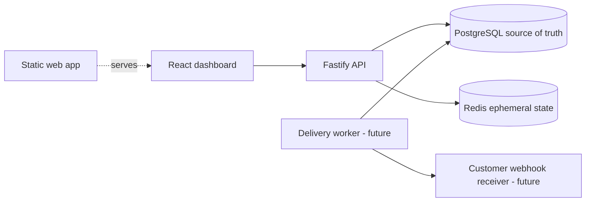
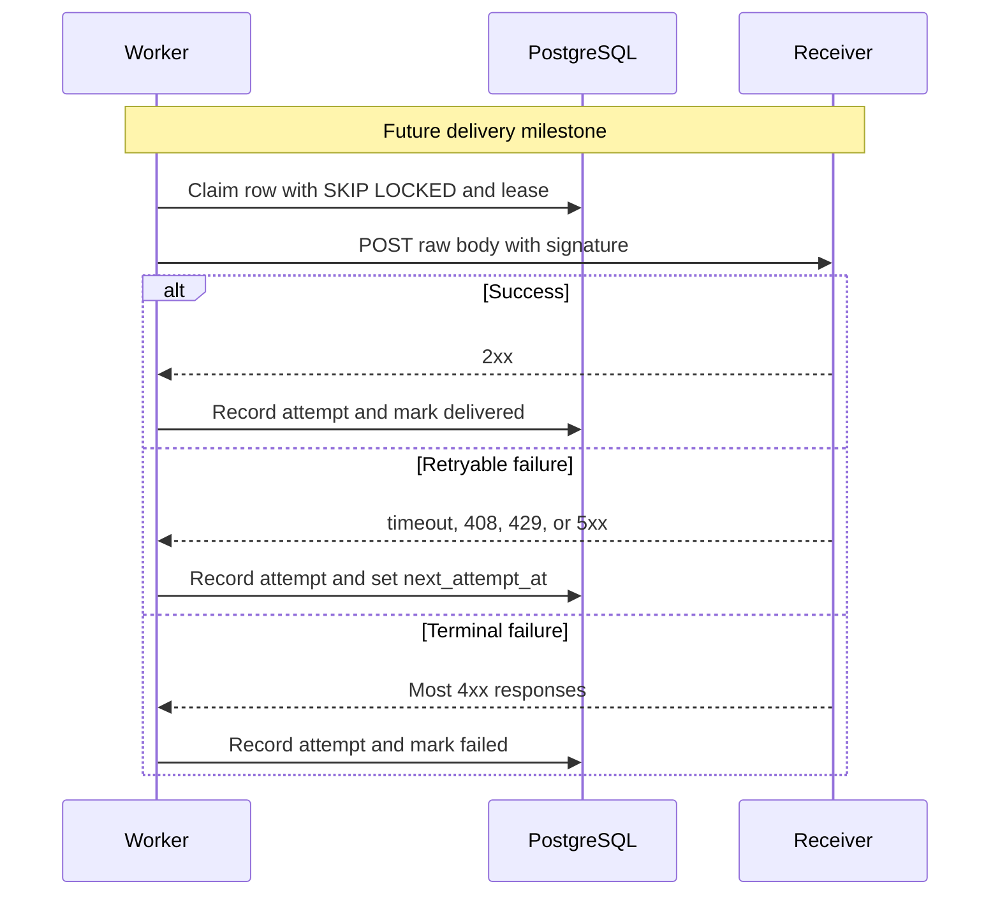
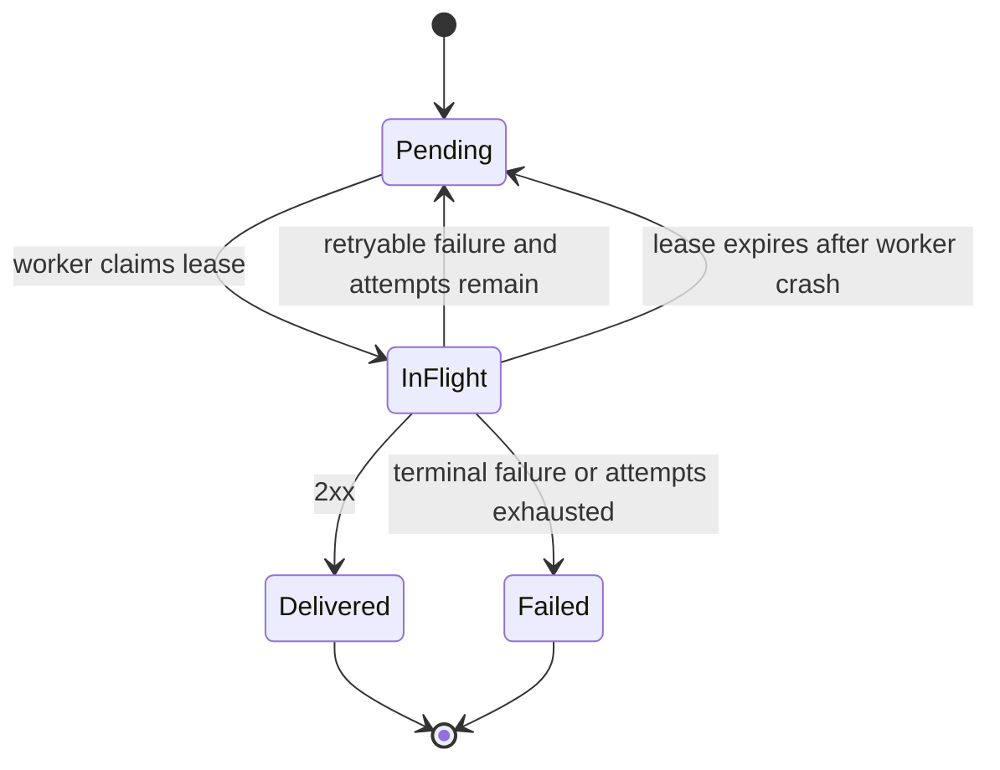
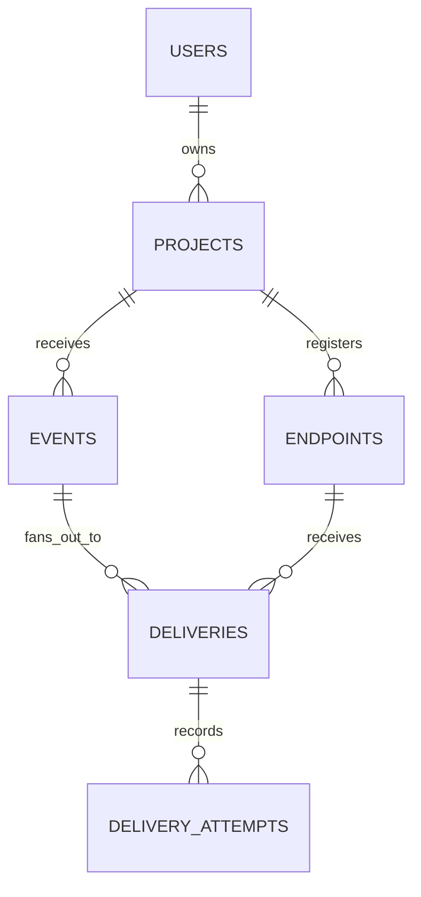
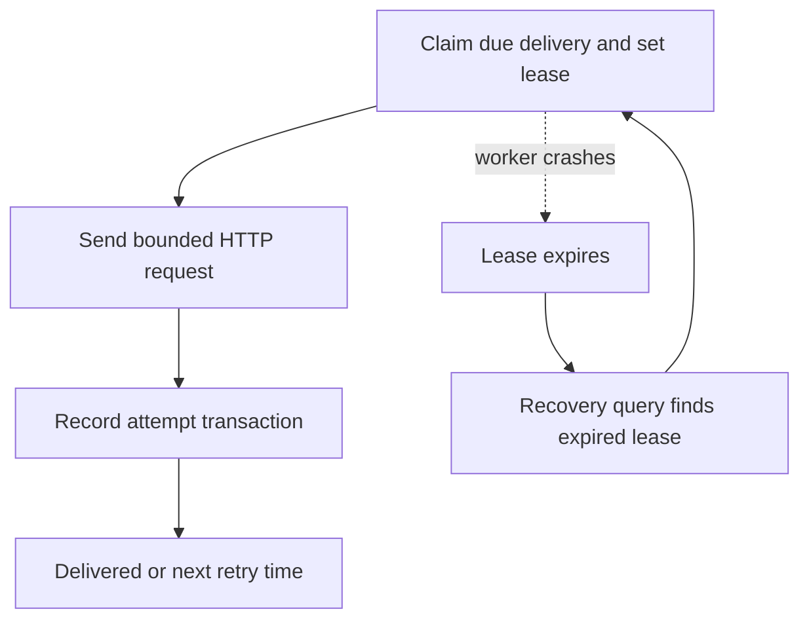
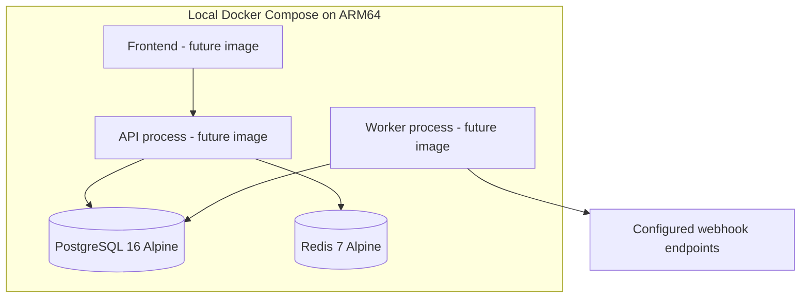

# Architecture diagrams

The solid foundation components are implemented now. Dashed nodes and flows
are the accepted delivery milestones and are intentionally marked as future
until their code lands.

## High-level component architecture



## Event ingestion sequence

```mermaid
sequenceDiagram
  participant C as Client
  participant A as API
  participant P as PostgreSQL
  participant W as Worker
  participant R as Receiver
  Note over A: Event and initial delivery rows commit atomically
  C->>A: POST /api/v1/projects/{id}/events
  A->>P: BEGIN; insert idempotency key, event, deliveries
  P-->>A: COMMIT
  A-->>C: 202 Accepted with event ID
  W->>P: Claim due delivery
  W->>R: Signed HTTP POST
```

## Delivery worker sequence



## Retry state machine



## Database entity relationships



The entities are part of the accepted target schema and will be introduced by
the domain-schema milestone.

## Failure recovery and abandoned jobs



## Deployment architecture


